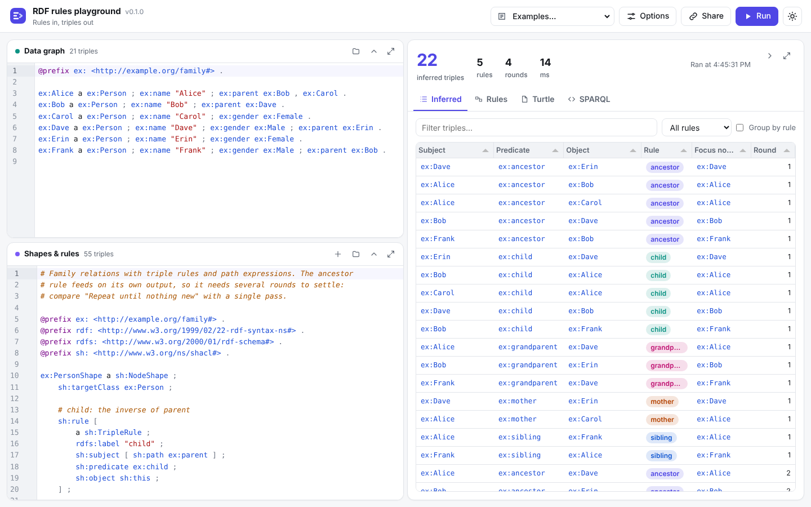
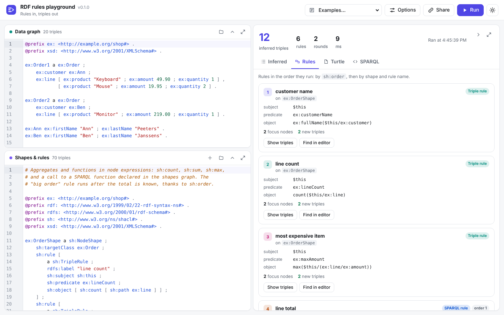

# rdf-rules-playground

Try [SHACL Advanced Features](https://www.w3.org/TR/shacl-af/) rules in your
browser. Type or paste a data graph and a shapes graph with `sh:rule`, and see
which triples the rules infer, which rule inferred each one, on which focus
node, and in which round. The same engine runs from the command line.



## Features

- **Triple rules** (`sh:TripleRule`) with node expressions for `sh:subject`,
  `sh:predicate` and `sh:object`.
- **SPARQL rules** (`sh:SPARQLRule`) with `sh:construct`, `sh:prefixes`, and
  `$this`, `$currentShape` and `$shapesGraph` pre-bound.
- **SPARQL 1.2 and RDF 1.2**: data and rules may use triple terms
  `<<( s p o )>>`, reifiers `<< s p o ~ r >>`, annotations `{| … |}` and
  directional language tags. SPARQL rules, functions and targets can match
  and build triple terms and call `TRIPLE`, `SUBJECT`, `PREDICATE`, `OBJECT`,
  `isTRIPLE`, `LANGDIR` and the other SPARQL 1.2 functions.
- **Conditions, order and deactivation**: `sh:condition` (checked with a full
  SHACL Core and SHACL-SPARQL validator), `sh:order`, `sh:deactivated`.
- **Iteration**: rules repeat until a round infers nothing new, so rules can
  build on each other's output. Switch it off to run each rule once.
- **Targets**: `sh:targetClass`, `sh:targetNode`, `sh:targetSubjectsOf`,
  `sh:targetObjectsOf`, implicit class targets, and SPARQL-based targets
  (`sh:target [ a sh:SPARQLTarget ; sh:select … ]`).
- **Explanations**: every inferred triple shows its rule, focus node and round;
  the Rules tab shows each rule's focus nodes, how many its conditions turned
  away, what it inferred, and its errors, without stopping the other rules.
- **SPARQL**: query the data with everything inferred in
  [MatGUI](https://github.com/Matdata-eu/MatGUI). "Try in SPARQL" opens a SPARQL
  rule's CONSTRUCT query there.
- **Editors** with Turtle highlighting, syntax errors marked on their line,
  rule templates, files opened or dropped in, and running while you type.
- **Big data graphs**: a data file in any RDF syntax, also gzipped, given to
  `serve` or opened in the browser. When it holds more triples than the editor
  takes (20 000 by default), it stays on the server and the data card becomes
  a MatGUI query view of it; the rules still run on all of it.
- **Focus**: collapse any section to its header, or maximize it to fill the
  window (Esc restores). The layout is remembered.
- **Share links** that hold both editors and the options, compressed into the
  URL. Nothing is stored on the server.
- **Turtle and N-Triples downloads** of the inferred triples, or of the data
  with the inferred triples added.
- Light and dark mode, and a phone layout.



### Node expressions

| Expression | Meaning |
| --- | --- |
| `sh:this` | The focus node. |
| an IRI or literal | Itself. |
| `[ sh:path p ]` | The values of the SHACL property path `p` from the focus node. |
| `[ sh:path p ; sh:nodes e ]` | The values of `p` from every node of `e`. |
| `[ sh:filterShape s ; sh:nodes e ]` | The nodes of `e` that conform to the shape `s`. |
| `[ sh:intersection ( e1 e2 … ) ]` | The nodes in every one of the expressions. |
| `[ sh:union ( e1 e2 … ) ]` | The nodes in any of the expressions. |
| `[ sh:count e ]` | The number of nodes of `e`, as an `xsd:integer`. |
| `[ sh:min e ]`, `[ sh:max e ]` | The smallest or largest value of `e`. |
| `[ sh:sum e ]` | The sum of the numbers of `e`, typed like SPARQL's `+`. |
| `( f e1 e2 … )` | A call to `f`, a `sh:SPARQLFunction` declared in the shapes graph, once for every combination of argument values. |

`sh:count`, `sh:min`, `sh:max` and `sh:sum` follow the SHACL 1.2 drafts;
the rest is in the SHACL-AF note.

## Install

From a release on GitHub (Linux, macOS, Windows), with Cargo, or as a Docker
image:

```sh
cargo install --git https://github.com/Matdata-eu/rdf-rules-playground
docker run --rm -p 8080:8080 ghcr.io/matdata-eu/rdf-rules-playground
```

## Usage

### The playground

```sh
rdf-rules-playground                     # opens the playground in your browser
rdf-rules-playground serve --data data.ttl --shapes rules.ttl   # with your files loaded
rdf-rules-playground serve --data big.nt.gz part2.ttl --shapes rules.ttl
```

`--data` takes one or more files in any syntax the command line reads (see
`--format` below). Small data opens in the data editor. Data with more triples
than `--max-editor-triples N` (default 20 000, or
`RDF_RULES_PLAYGROUND_MAX_EDITOR_TRIPLES`) is loaded once and kept on the
server: the data card then shows the file names and a MatGUI query view over
`/api/data/{id}/sparql`, and every run uses that graph. **Use the editor**
switches back to typing data, and **Use loaded data** returns to the files.
Files opened or dropped in the browser work the same way. Share links never
hold data kept on the server.

Runs on big data list the first 20 000 inferred triples in the table; the
summary counts all of them, and the downloads and the SPARQL tab have all of
them.

It starts with the first example; the **Examples** menu has five:

| Example | Shows |
| --- | --- |
| Rectangles (from the spec) | The two examples of the SHACL-AF note: a triple rule with conditions, a SPARQL rule. |
| Family relations | Path expressions, `sh:union`, `sh:filterShape`, and a rule that needs several rounds. |
| Orders: aggregates and functions | `sh:count`, `sh:sum`, `sh:max`, a SPARQL function call, and `sh:order`. |
| Cities: SPARQL target | A SPARQL-based target, and a deactivated rule. |
| Claims: SPARQL 1.2 and triple terms | Reified claims with a confidence; rules state the confident ones, flag the doubtful ones as triple terms, and build triple terms with `TRIPLE()`. |

Press **Ctrl+Enter** (Cmd+Enter on a Mac) to run, or leave "Run while typing"
on. Under **Options**:

- **Repeat until nothing new**: iterate to a fixpoint (on by default). A rule
  that creates a blank node, or a new value, every time it runs never settles;
  the run then stops after **Most rounds** and says so.
- **Read rules from the data too**: for files that keep data and shapes together.

The SPARQL tab queries the data graph with everything inferred. The shapes
graph is the named graph `<urn:x-rdf-rules-playground:shapes-graph>`. Each run
has its own endpoint at `/api/runs/{id}/sparql`, so it also works from other
SPARQL clients while the playground keeps that run (the last 32 runs).

### From the command line

```sh
rdf-rules-playground infer --data data.ttl --shapes rules.ttl
```

prints the inferred triples as Turtle. Without `--shapes`, the rules are read
from the data graph.

| Option | |
| --- | --- |
| `-d, --data FILE…` | Data graph files (Turtle, N-Triples, RDF/XML, TriG, N-Quads, also gzipped); `-` reads Turtle from standard input. |
| `-s, --shapes FILE…` | Shapes graph files holding the rules. |
| `--format FORMAT` | Syntax of every input file, if the extension does not tell. |
| `-o, --output FILE` | Write to a file instead of standard output. |
| `--output-format turtle\|ntriples` | Syntax of the result. |
| `--all` | Write the data graph with the inferred triples added. |
| `--single-pass` | Run every rule once instead of repeating until nothing new is inferred. |
| `--max-iterations N` | Most rounds (default 100). |
| `--explain` | Print, for every rule, its focus nodes, how many its conditions turned away, and what it inferred. |
| `-q, --quiet` | Print only errors on standard error. |

```console
$ rdf-rules-playground infer -d examples/rectangles/data.ttl -s examples/rectangles/rules.ttl --explain
@prefix ex: <http://example.org/shapes#> .

ex:NonSquareRectangle
    ex:area 6 .

ex:SquareRectangle
    a ex:Square ;
    ex:area 16 .

rule Area [sparql on <http://example.org/shapes#Rectangle>, order 0]: focus-nodes=2 skipped-by-condition=1 inferred=2 already-present=0
rule Squares [triple on <http://example.org/shapes#Rectangle>, order 0]: focus-nodes=1 skipped-by-condition=2 inferred=1 already-present=0
rules=2  rounds=2  inferred=3  in 5 ms
```

The exit code is 0 on success, 1 when a rule failed or a limit stopped the
run, and 2 when the input could not be read.

### Hosting it

`serve --public` (or `RDF_RULES_PLAYGROUND_PUBLIC=true`, as in the Docker image)
runs the playground as a public website: it never opens a browser and caps
every request.

| Flag | Environment variable | Default |
| --- | --- | --- |
| `--bind ADDR` | `RDF_RULES_PLAYGROUND_BIND` | `127.0.0.1:0` (Docker: `0.0.0.0:8080`) |
| `--public` | `RDF_RULES_PLAYGROUND_PUBLIC` | off (Docker: on) |
| `--max-input-bytes BYTES` | `RDF_RULES_PLAYGROUND_MAX_INPUT_BYTES` | 2 MB per editor |
| `--max-triples N` | `RDF_RULES_PLAYGROUND_MAX_TRIPLES` | 50 000 per editor, and inferred |
| `--max-seconds S` | `RDF_RULES_PLAYGROUND_MAX_SECONDS` | 20 per run or query |

Public runs are also limited to 50 rounds, and to as many at once as the
machine has cores.

## How rules run

1. Every `sh:rule` in the shapes graph is collected and sorted by `sh:order`
   (default 0), then by shape and by rule label, so runs are repeatable.
2. For each rule that is not deactivated, the focus nodes are the targets of
   its shape, minus those that do not conform to every `sh:condition`.
3. The rule runs on each focus node. New triples go into the data graph
   straight away, so the next rule already sees them.
4. When a round inferred something, the next round starts at step 2. A round
   that infers nothing new ends the run.

## Not supported

- `sh:values` and `sh:defaultValue` on property shapes.
- `sh:JSRule` and JavaScript functions.
- Function expressions over SPARQL's built-in functions; declare a
  `sh:SPARQLFunction` instead.
- Custom target types (`sh:SPARQLTargetType`).

## Development

```sh
cargo fmt --all -- --check
cargo clippy --all-targets --locked -- -D warnings
cargo test --locked
```

The web assets in `assets/` are embedded in the binary at compile time. The
SHACL validator in `src/validate` comes from
[shacl-report](https://github.com/Matdata-eu/shacl-report), where it is tested
against the W3C SHACL test suite.

Third-party browser code is vendored under `assets/vendor`: MatGUI (MIT),
Tabulator (MIT) and CodeMirror 6 with a Turtle grammar (MIT). The `NOTICE.md`
files there list versions and how to rebuild the bundles.

## License

Apache-2.0. The rule engine is this crate's own (`src/rules`), built on the
[Oxigraph](https://github.com/oxigraph/oxigraph) crates (`oxrdf`, `oxttl`,
`oxrdfxml`, `spargebra`, `spareval`, `sparesults`; MIT or Apache-2.0) for
RDF parsing and SPARQL. Every third-party package compiled into the binary or
bundled into its web assets uses a permissive license (MIT, Apache-2.0, BSD,
ISC, Zlib, Unicode-3.0, MPL-2.0 as an alternative, and the SIL OFL for the
Font Awesome font). [THIRD_PARTY_NOTICES.md](THIRD_PARTY_NOTICES.md) lists
them with their license texts; the running playground serves it at
`/licenses` (Options menu). Regenerate it with
`scripts/third_party_notices.py` when dependencies change.
